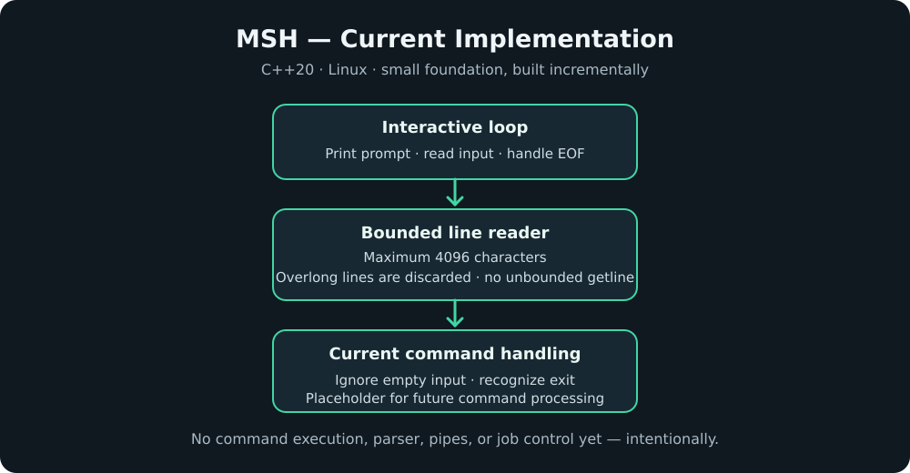

# MSH — A Unix Shell in C++

**MSH** is a small, modular Unix-shell project written in C++20. The project is being developed incrementally to learn and implement operating-system interfaces, parsing, process control, file descriptors, pipelines, and job control.

> This repository is at its foundation stage. It currently implements an interactive prompt, bounded input, empty-line handling, `exit`, and EOF handling. It does **not** execute external commands yet.

## Current implementation



### Current features

- Interactive `msh$` prompt.
- Input limit of 4096 characters, enforced while reading.
- Oversized input is discarded through the end of that line.
- Empty lines are ignored.
- `exit` exits the shell.
- EOF (Ctrl+D on an interactive terminal) exits cleanly.
- C++20 with compiler warnings enabled.
- Smoke tests for basic input, empty input, and oversized input.

## Build

Requirements: Linux (or WSL2 Ubuntu), GCC/G++, GNU Make.

```bash
make
./msh
```

Build with AddressSanitizer and UndefinedBehaviorSanitizer:

```bash
make debug
```

Run the smoke tests:

```bash
make test
```

Clean build output:

```bash
make clean
```

## Project structure

```text
msh/
├── src/
│   └── main.cpp
├── docs/
│   └── architecture.svg
├── tests/
│   └── smoke.sh
├── Makefile
├── README.md
├── LICENSE
└── .gitignore
```

We will add modules only when their responsibilities are introduced. The goal is understandable code, small components, explicit ownership, testability, and room to extend—not complexity for its own sake.

## Roadmap

- [x] Foundation: prompt and bounded input
- [ ] Lexer and token model
- [ ] Parser and command representation
- [ ] Builtins (`cd`, `pwd`, `exit`, environment operations)
- [ ] External process execution (`fork`/`exec`/`waitpid`)
- [ ] Redirection
- [ ] Pipelines
- [ ] Signal handling and process groups
- [ ] Job control
- [ ] History and expansions
- [ ] Hardening, fuzzing, and broader tests

Roadmap items are planned, not implemented. The compatibility goal is a deliberate POSIX-oriented subset, not full POSIX shell compatibility.

## Engineering principles

1. **Keep it understandable.** Prefer straightforward code over clever abstractions.
2. **Modularize when there is a real boundary.** Avoid premature files, classes, or frameworks.
3. **Build in small working increments.** Every milestone compiles and has tests.
4. **Be honest about functionality.** README and help text describe implemented behavior only.
5. **Use system interfaces deliberately.** Learn process, signal, and file-descriptor semantics rather than hiding them behind a library.
6. **Harden by design.** Bound input, handle errors, test edge cases, and use sanitizers.

## Contributing / development

The shell is a learning and systems-programming project. Issues and changes should be scoped to a milestone, include tests where applicable, and avoid adding dependencies without a clear reason.

## License

MIT. See [LICENSE](LICENSE).
